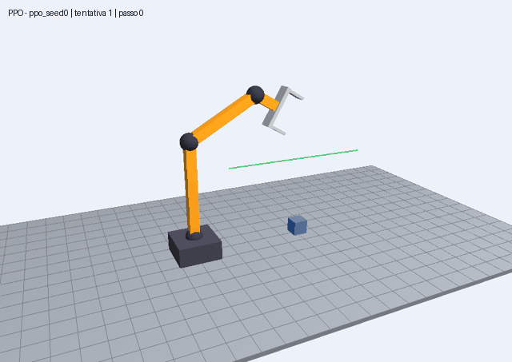
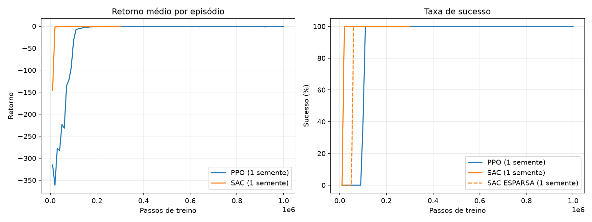
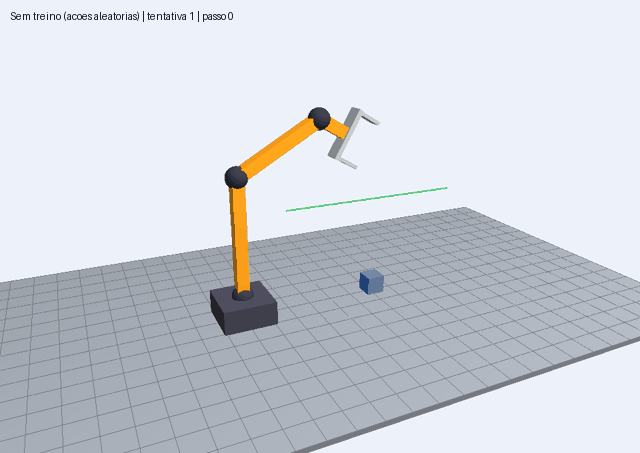
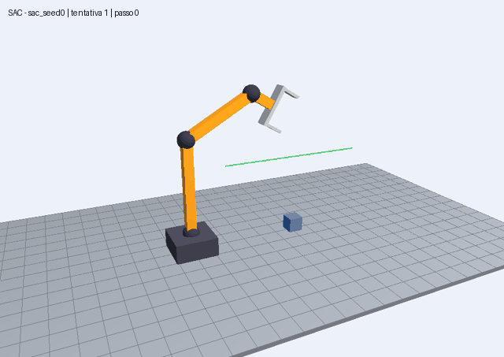

# Garra robótica com Aprendizado por Reforço (PPO e SAC) em OpenGL

Trabalho da disciplina de **Computação Gráfica**: um braço robótico com garra, desenhado em **OpenGL**, que aprende sozinho a **pegar uma caixa e levantá-la** usando aprendizado por reforço. Comparamos dois algoritmos da biblioteca **Stable-Baselines3**: o **PPO** (Proximal Policy Optimization) e o **SAC** (Soft Actor-Critic).

<p align="center">
  
</p>

## Como funciona

- **Braço:** 3 juntas (ombro, cotovelo e punho) mais a garra. Todas as juntas giram no mesmo eixo, então o braço se move num plano vertical, mas é desenhado em 3D.
- **Juntas com ângulo limitado:** nenhuma junta dá a volta de 360°. Ombro de 10° a 170°, cotovelo de −150° a 150°, punho de −120° a 120°.
- **Ações contínuas:** a cada passo o agente escolhe 4 números entre −1 e 1 (quanto girar cada junta, até 4° por passo, e quanto abrir ou fechar a garra).
- **Observação:** 17 números (senos, cossenos e ângulos das juntas, abertura da garra, posição da ponta, posição da caixa, distância entre elas e se está segurando).
- **Recompensa em etapas:** chegar perto da caixa, agarrar (+2), levantar até 0,40 m (+10 no sucesso), com pequenas penalidades por movimentos bruscos e por bater no chão. Existe também uma recompensa **esparsa** (só +10 no sucesso) para mostrar um treino que dá errado.
- **Desenho:** modelagem hierárquica em OpenGL com `glPushMatrix`, `glRotate` e `glTranslate`.

## Arquivos

| Arquivo | O que faz |
|---|---|
| `ambiente.py` | A simulação no padrão Gymnasium: braço, garra, caixa e recompensa |
| `render.py` | O desenho em OpenGL (chão, caixa, braço e garra) |
| `treinar.py` | Treina o PPO ou o SAC e salva os modelos em `modelos/` |
| `avaliar.py` | Mostra o braço treinado na janela e calcula a taxa de sucesso |
| `gravar.py` | Grava episódios em GIF (pasta `videos/`) |
| `graficos.py` | Gera as curvas de aprendizado PPO x SAC (`graficos/curvas.png`) |
| `controle_manual.py` | Controle do braço pelo teclado, para testar |
| `testar_ambiente.py` | Teste rápido do ambiente, sem janela |
| `artigo.tex`, `metodologia_*.tex`, `resultados_conclusao.tex` | Textos do artigo em LaTeX |

## Como rodar

Precisa do Python 3 instalado. Dentro da pasta do projeto:

```bash
python -m pip install -r requirements.txt
```

1. Testar a simulação (sem janela):
   ```bash
   python testar_ambiente.py
   ```
2. Ver o OpenGL e mexer o braço pelo teclado (Q/A ombro, W/S cotovelo, E/D punho, F fecha, O abre, R recomeça, setas e Z/X câmera):
   ```bash
   python controle_manual.py
   ```
3. Treinar (roda sem janela; é a parte demorada):
   ```bash
   python treinar.py --algo sac --passos 300000
   python treinar.py --algo ppo --passos 1000000
   python treinar.py --algo sac --recompensa esparsa   # treino que costuma falhar
   ```
4. Assistir ao braço treinado e medir a taxa de sucesso:
   ```bash
   python avaliar.py --algo ppo --modelo modelos/ppo_seed0/best_model.zip
   python avaliar.py --algo sac --modelo modelos/sac_seed0/best_model.zip --episodios 100 --sem-janela
   ```
5. Gerar os gráficos e os GIFs:
   ```bash
   python graficos.py
   python gravar.py --algo ppo --modelo modelos/ppo_seed0/best_model.zip --saida videos/ppo.gif
   ```
6. (Opcional) Acompanhar o treino ao vivo:
   ```bash
   python -m tensorboard.main --logdir logs
   ```

> Os modelos treinados (`.zip`) e os logs do TensorBoard não vão para o GitHub porque são pesados. Para tê-los, rode o passo 3.

## Resultados

Com a recompensa em etapas, os dois algoritmos aprenderam a tarefa (semente 0, avaliação em 100 episódios):

| Algoritmo | Passos de treino | 1º 100% de sucesso | Sucesso final | Passos por episódio |
|---|---|---|---|---|
| PPO | 1.000.000 | 110.000 passos | 100% | 15,1 |
| SAC | 300.000 | 20.000 passos | 100% | 15,3 |

O SAC precisou de bem menos passos (aproveita a experiência antiga pelo replay buffer), e o PPO roda cada passo mais rápido (vários ambientes em paralelo).



| Sem treino (ações aleatórias) | SAC com recompensa esparsa (deu errado) |
|---|---|
|  |  |
| **SAC treinado (deu certo)** | **PPO treinado (deu certo)** |
|  |  |

## Limitações

- A física é simplificada: a caixa "gruda" na garra quando ela fecha perto o suficiente e cai em linha reta quando a garra abre. Não há atrito real.
- O braço se move em um plano, mas é desenhado em 3D.
- Uma caixa por episódio, em posição sorteada no chão.

## Referências

- SCHULMAN, J. et al. **Proximal Policy Optimization Algorithms**. arXiv:1707.06347, 2017.
- HAARNOJA, T. et al. **Soft Actor-Critic: Off-Policy Maximum Entropy Deep Reinforcement Learning with a Stochastic Actor**. In: International Conference on Machine Learning (ICML), 2018.
- RAFFIN, A. et al. **Stable-Baselines3: Reliable Reinforcement Learning Implementations**. Journal of Machine Learning Research, v. 22, n. 268, p. 1-8, 2021.
